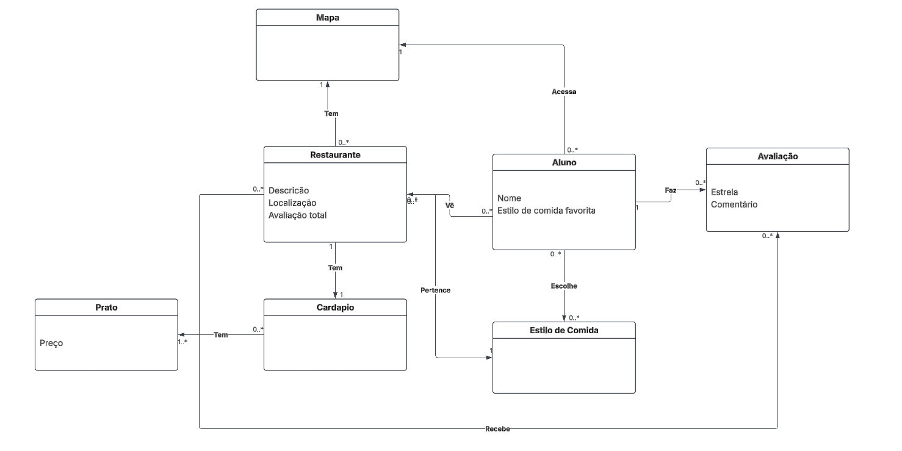

# noPonto

Aplicação web para alunos da PUC-Rio descobrirem onde comer no campus Gávea: restaurantes, cardápios e avaliações por estrelas em um só lugar.

Projeto da disciplina ENG4021 — 2026.2, 33B.

## Integrantes

Bernardo Lazarini
Luiz Brizzante
Felipe Iglesias
Rafael Vilela
João Pedro Simas

## Funcionalidades

- Cadastro e login de alunos (a senha é guardada com hash)
- Lista de restaurantes com nota média, busca por nome e filtro por estilo de comida
- Página do restaurante com descrição, cardápio e avaliações
- Avaliação de restaurantes (de 1 a 5 estrelas, com comentário)
- Controle de acesso: sem login, as páginas redirecionam para o login
- Gerenciamento de usuários: listar, editar e excluir (cada aluno altera só a própria conta)

## Tecnologias

- Python 3 e Django
- SQLite (banco de dados)
- HTML e CSS
- Desenvolvimento no GitHub Codespaces

## Como rodar

```bash
git clone https://github.com/BernardoLazarini/Projeto-de-Software
cd Projeto-de-Software/site

python -m venv venv
source venv/bin/activate        
pip install -r requirements.txt

python manage.py migrate
python manage.py createsuperuser
python manage.py runserver
```

Depois, abra `http://127.0.0.1:8000/`. No Codespaces, abra a porta 8000 pela aba **Ports**.

> O `manage.py` precisa estar na pasta onde você roda os comandos. O `db.sqlite3` não vai para o repositório, então cada pessoa cria o seu com o `migrate`.

### Popular o banco

Os restaurantes são cadastrados pelo painel `/admin` (entre com o superusuário), nesta ordem:
estilos de comida, mapa, restaurantes, cardápios e pratos. Alunos e avaliações são criados pelo próprio site.

## Principais rotas

| Endereço | O que abre |
|---|---|
| `/` | login |
| `/cadastro/` | cadastro de aluno |
| `/restaurantes/` | lista de restaurantes |
| `/restaurantes/<id>/` | detalhe, cardápio e avaliações |
| `/usuarios/` | lista de usuários |
| `/usuarios/<id>/editar/` | editar o próprio perfil |
| `/usuarios/<id>/excluir/` | excluir a própria conta |
| `/sair/` | sair |
| `/admin/` | painel de administração |

## Modelo de dados

Tabelas: `EstiloComida`, `Mapa`, `Restaurante`, `Cardapio`, `Prato`, `Aluno` e `Avaliacao`.

- Um restaurante tem um cardápio (1 para 1) e um cardápio tem vários pratos
- Um restaurante tem várias avaliações, e cada avaliação é de um aluno
- Alunos escolhem estilos de comida favoritos (N para N)
- A nota média do restaurante é calculada a partir das avaliações, e não é guardada



## Estrutura de pastas
```text
site/
|── noPonto/
|   |──statics/
|   |  |──css/
|   |  |  |──conta-estilo.css
|   |  |  |──EscolhaFavoritos.css
|   |  |  |──home.css
|   |  |  |──login.css
|   |  |  |──restaurantes.css
|   |  |──img/
|   |  |  |──logoNoPonto.png
|   |──templates/
|   |  |──cadastro.html
|   |  |──editarperfil.html
|   |  |──EscolhaFavoritos.html
|   |  |──excluirconta.html
|   |  |──home.html
|   |  |──listausuarios.html
|   |  |──login.html
|   |  |──restaurante.html
|   |  |──restaurantes.html
|   |  |──termodeuso.html
|   |──__init__.py
|   |──asgi.py
|   |──models.py
|   |──settings.py
|   |──urls.py
|   |──views.py
|   |──wsgi.py
|──manage.py
|──requirements.txt
```

## Organização do time

- Metodologia: sprints, com Kanban no EAD
- Cada tarefa é feita em uma branch própria e entra na `main` por pull request, aceito pelo líder do repositório

## Estratégia para atrair usuários
```text
Estratégias para atrair novos usuários:
O grupo reconhece que a praticidade e utilidade do NoPonto! será melhor percebido ao utilizar o site, fazendo com que a simples atração dos primeiros usuários, podemos dizer, os pioneiros do site, será a parte mais complicada de todo o processo. Ao ver a capacidade de melhora que o webapp proporciona, eles irão ser a ferramenta de divulgação mais importante e de melhor capacidade de persuasão para a adesão ao aplicativo. 
Para tentar promover o site, em primeira instância, é importante a adesão às redes sociais, onde o público-alvo, alunos universitários, está mais envolvido. 
Primeiro, vai ser criada uma conta de Instagram e no TikTok para a divulgação do site. Publicar postagens no feed e vídeos curtos que utilizam tendências do momento para aumentar o engajamento da população jovem. Com tais tendências e modas, o algoritmo desses aplicativos tendem a repercutir mais a postagem, aumentando o alcance e, consequentemente, aumentando a visibilidade e o conhecimento que o site terá. 
A divulgação do site continuará até conseguirmos identificar, dentro da base de dados do site, a criação dos primeiros usuários. Isso vai mostrar a eficiência das postagens. 
Quando os primeiros usuários forem criados, vamos disponibilizar panfletos no pilotis e nos refeitórios da faculdade para tentar aumentar a visibilidade do site de maneira física para o público-alvo. Dessa forma, um contato mais físico com a solução consegue quebrar uma barreira mental sobre a materialidade da solução e toda a sua capacidade de ajuda. 
A partir desse momento, conseguimos identificar que o fenômeno do “word of mouth” será o maior aliado para a divulgação. Ao ter mais clientes e usuários e ao conseguir demonstrar pelo funcionamento do aplicativo a sua utilidade, o público, inconscientemente, vai começar a entrar em contato com a aplicação através das relações pessoais com colegas no ambiente universitário. 
Assim, o começo da utilização do site conseguirá ser concretizado.
```
## Limitações conhecidas

- Curso e matrícula aparecem no cadastro, mas ainda não são gravados
- A página do Termo de Uso ainda não tem rota
- O mapa com os restaurantes ainda nao foi implementado
